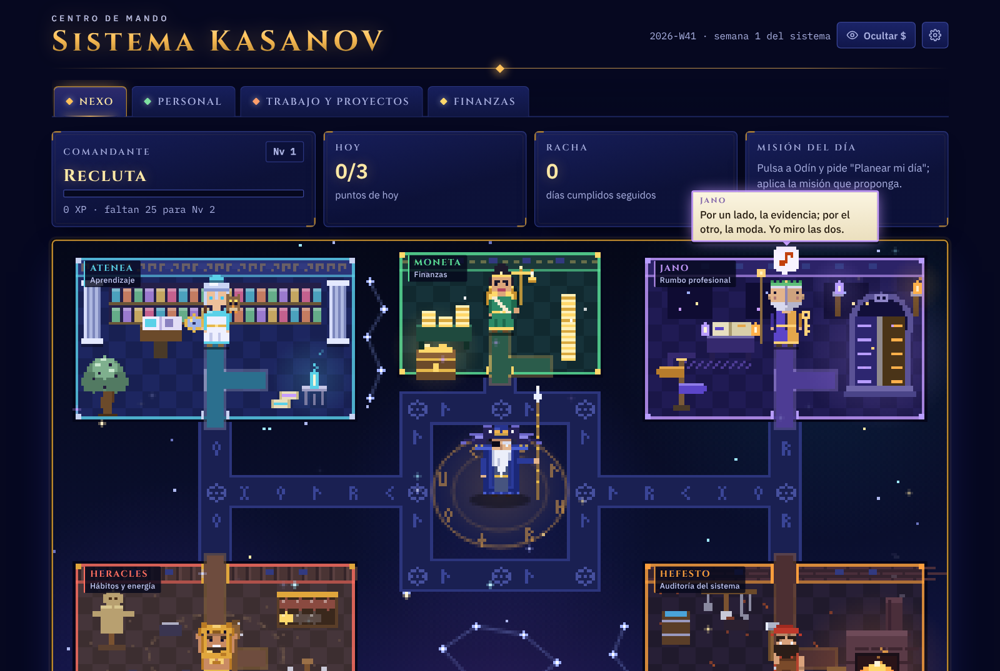

# Sistema KASANOV

Centro de mando personal con estilo de videojuego. Un escuadrón de agentes de IA (Claude) te ayuda a sostener tus hábitos, avanzar tus proyectos, repasar lo que aprendes, cuidar tu dinero y tomar decisiones con evidencia. Cada agente es una figura mitológica con su sala, su cara y su carácter: Odín en el centro y Atenea, Jano, Heracles, Moneta y Hefesto alrededor. Los ves caminar por pasillos de runas, pasarse información y reunirse en el Nexo mientras trabajan.



Es una sola página web, sin servidor, sin frameworks y sin paso de compilación.

## Qué incluye

| Área | Qué hace |
|---|---|
| **Nexo** | Mapa pixel de la base. Cada departamento es un agente con su sala, su carácter y sus rutinas. Haz clic en un agente y se abre **su chat**, con historial guardado (un resumen rodante más los últimos 10 mensajes) y un **Expediente**: lo que sabe de ti en su área y sus recomendaciones con fecha y estado (pendiente, hecha o ignorada). Odín tiene su propio chat y desde ahí despachas misiones: cada agente entrega un **despacho** en JSON (hallazgo, evidencia, recomendación con duración y criterio de terminado, confianza, para quién y una pregunta opcional) en orden fijo Heracles → Moneta → Jano → Atenea → Hefesto, y cada uno lee los despachos anteriores. Odín descarta todo despacho que no cite un dato concreto, propone de 1 a 3 acciones con hora y criterio de terminado, explica cómo resolvió los choques entre agentes y actualiza el **Tablero de estado** (capacidad de hoy, urgencia, dirección, huecos y misión del día). Cada agente recibe solo sus fuentes; Odín, solo los despachos y el Tablero. Cada despacho y cada acción se califican con **Útil**, **Ya lo sabía** o **No aplica** (con nota opcional) y, al cerrar el día, marcas la misión del día como cumplida, parcial o no cumplida con un motivo rápido. Con eso cada agente guarda en su expediente «lo que funciona contigo» y «lo que no» y lo consulta antes de recomendar; si una misión falla dos veces por «no supe cómo», Odín la divide en pasos chicos. Antes de entregar, cada despacho pasa una autorrevisión (dato concreto, cabe en la capacidad de hoy, criterio de terminado, nada marcado «No aplica»). En la revisión semanal Odín dice qué agente fue más útil y Hefesto propone ajustar la misión del peor; tú lo apruebas. Si pones tu usuario de GitHub en Ajustes, una vez al día consulta tu actividad pública (sin token) y los agentes la ven como SEÑALES: días desde el último commit por repo, repos activos y proyectos en curso con o sin commits; si un proyecto tiene commits pero nada en la bitácora, Atenea te pregunta qué aprendiste ahí. Si GitHub no responde, todo sigue funcionando. Lo que proponen (tarjetas, proyectos, habilidades, misión del día) se aplica solo si tú lo apruebas. Con **Registrar avance** cuentas lo que ya hiciste y queda anotado al instante en tu bitácora, proyectos y habilidades, sin preguntas y con opción de deshacer. |
| **Personal** | Hoy: hábitos, bonus, puntos, minutos de estudio, energía y una bitácora de cinco campos cortos (Hice, Aprendí, Me trabé, Decidí y Siguiente; este último es obligatorio para cerrar el día), cada uno con etiqueta opcional de proyecto o tema. El botón flotante **Nota rápida** guarda texto libre en una Bandeja sin clasificar; al cerrar el día mueves cada nota a uno de los cinco campos o la descartas. Semana: gráfica, adherencia, mapa de 4 semanas y progresión. Mis hábitos: los editas tú. |
| **Trabajo y proyectos** | Proyectos en tablero (ideas, en curso, por publicar, terminado). Habilidades separadas en probadas, en práctica y sin probar: solo cuenta lo que tiene evidencia. Repaso con repetición espaciada y evaluación opcional de Claude. |
| **Finanzas** | Cuentas, gastos, ingresos, meses de colchón y rendimiento estimado. Consultas de decisiones: Finanzas lidera y el Nexo da un veredicto (Sí, No, Depende o Esperar). |
| **Engranaje** | Revisión semanal del escuadrón, tu meta, solicitudes de mejora, departamentos y ajustes. En Ajustes está el **Perfil del comandante** que reciben todos los agentes: meta y fecha objetivo, restricciones reales, cómo aprendes, tus patrones y lo que no quieres que te recomienden. Los agentes pueden proponer patrones nuevos, pero solo entran si los apruebas. |

Además, el botón **Ocultar $** tapa todas las cifras de dinero de la pantalla, incluidas las que aparecen en los textos de los agentes.

## El escuadrón

Los agentes conservan sus identificadores internos (`aprendizaje`, `carrera`, `habitos`, `finanzas`, `sistema`); la figura mitológica es su apariencia, su sala y su voz.

| Figura | Área | Cómo se ve y cómo habla |
|---|---|---|
| **Odín** | Nexo (orquesta) | Anciano de un solo ojo con lanza y dos cuervos, Hugin y Munin, que vuelan hacia los agentes cuando reparte una misión. Habla con calma y peso, como quien ya vio el final. |
| **Atenea** | Aprendizaje | Casco, escudo y una lechuza en el hombro; sala de biblioteca-templo con columnas y un olivo. Estratega exigente: pregunta como Sócrates y no acepta respuestas a medias. |
| **Jano** | Rumbo profesional | Dos caras que miran a lados opuestos; su sala es una gran puerta doble. Siempre presenta dos caminos y lo que cuesta cada uno. |
| **Heracles** | Hábitos y energía | Piel de león y maza; sala de arena de entrenamiento. Motivador y ruidoso: celebra cada esfuerzo como una hazaña. |
| **Moneta** | Finanzas | Figura romana con balanza; sala de casa de acuñación con monedas. Fría y precisa: habla en cifras. |
| **Hefesto** | Auditoría del sistema | Herrero con martillo y delantal; sala de forja con yunque y chispas. Artesano gruñón y perfeccionista. |

En reposo cada uno tiene su animación (la lechuza parpadea, saltan chispas en la forja, Jano gira la cabeza) y suelta frases sueltas por el mapa. Mientras corre una misión, Odín se rodea de un aura y se encienden rastros de luz entre los agentes que participan. Con `prefers-reduced-motion` las animaciones se reducen al mínimo.

## Cómo usarlo

1. Descarga el repositorio (botón **Code → Download ZIP**) o clónalo:
   ```bash
   git clone https://github.com/<tu-usuario>/sistema-kasanov.git
   ```
2. Abre `index.html` en tu navegador. Funciona con doble clic, sin instalar nada.
3. Entra al engranaje → **Ajustes**, pega tu API key de Anthropic, pulsa **Probar conexión** y luego **Guardar y recargar**. La API key se consigue en [console.anthropic.com](https://console.anthropic.com/) → API Keys.
4. En **Ajustes → Quién eres** escribe tu nombre y algo de contexto, y llena el **Perfil del comandante**. Los agentes usan esos datos en cada chat y en cada misión. Los ejemplos de despacho bueno y malo de cada agente están en `js/app.js` (`DESP_EX`); cámbialos por ejemplos con tus propios datos para mejorar la calidad.

Sin API key funciona todo menos los agentes: hábitos, proyectos, habilidades, repaso y finanzas siguen disponibles.

## Publicarlo con GitHub Pages

En tu repositorio ve a **Settings → Pages → Build and deployment**, elige **Deploy from a branch**, la rama `main` y la carpeta `/ (root)`. En un par de minutos queda en `https://<tu-usuario>.github.io/sistema-kasanov/`.

Cada persona que lo abra usa sus propios datos y su propia API key. Nada se comparte entre visitantes.

## Privacidad y seguridad

- **Tus datos** viven en el almacenamiento local de tu navegador (`localStorage`). No hay servidor ni base de datos en la nube.
- **Lo único que sale de tu equipo con tus datos** son las llamadas a la API de Anthropic, con el contexto que cada misión necesita (tus hábitos recientes, proyectos, habilidades y números). Aparte, el navegador descarga las tipografías (Cinzel, IBM Plex y Pixelify Sans) de Google Fonts; si prefieres cero llamadas externas, sírvelas desde archivos locales.
- **La API key** se guarda en ese mismo almacenamiento local y las llamadas van directo de tu navegador a Anthropic (con el encabezado `anthropic-dangerous-direct-browser-access`). Úsalo en tu propio equipo, nunca pongas tu key dentro del código y configura un límite de gasto en la consola de Anthropic.
- **Respaldos**: en Ajustes puedes descargar e importar un archivo JSON con todos tus datos. Ese archivo es personal: no lo subas al repositorio. El `.gitignore` ya excluye los archivos `*respaldo*.json`.

## Costos

Cada misión hace una llamada de planeación con el modelo rápido, una por cada agente que participa con el modelo normal y una de síntesis. Una revisión semanal involucra a todo el escuadrón. El costo depende de los precios vigentes de Anthropic: consúltalos en [anthropic.com/pricing](https://www.anthropic.com/pricing).

## Modelos

Por defecto usa `claude-haiku-4-5-20251001` (rápido), `claude-sonnet-5-5` (normal) y `claude-opus-5-5` (complejo). Puedes cambiarlos en **Ajustes**. Si alguno deja de estar disponible, reemplázalo por uno vigente de la [lista oficial de modelos](https://docs.claude.com/en/docs/about-claude/models/overview).

## Cómo está hecho

```
index.html        estructura de la página
css/styles.css    estilos (tema de santuario nocturno)
js/app.js         la aplicación: mapa pixel, figuras de los agentes, orquestación y secciones
js/runtime.js     capa de ejecución: base de datos local y llamadas a Claude
docs/             imágenes del README
```

La app nació como un artifact de Claude, que le da a la página una base de datos, llamadas a Claude y conectores. `js/runtime.js` reemplaza esas capacidades para que funcione en cualquier navegador:

- **Base de datos**: guarda documentos en `localStorage` con una API tipo Firestore (`doc`, `collection`, `where`, `orderBy`, `limit`, `onSnapshot`). Si abres dos pestañas, ambas se sincronizan.
- **Claude**: llama a la API de Mensajes de Anthropic con tu key y lee respuestas JSON.

Para sincronizar entre dispositivos puedes reemplazar la base de datos local por Firebase o Supabase implementando esa misma interfaz en `runtime.js`. `app.js` no necesita cambios.

## Diferencias con la versión dentro de Claude

- La revisión semanal no corre sola el domingo: la lanzas desde el engranaje con **Correr revisión ahora**.
- Los datos no se sincronizan entre dispositivos; usa los respaldos para moverlos.
- Auditoría del sistema propone mejoras, pero no puede editar el código por sí misma.

## Licencia

[MIT](LICENSE)
